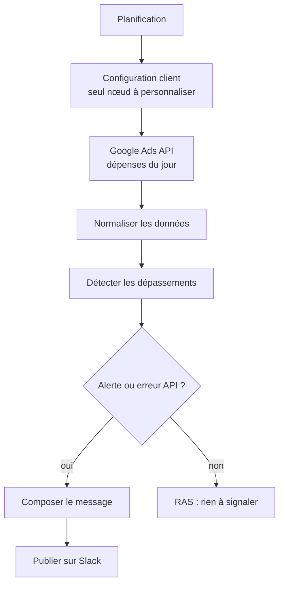

# Google Ads — Alertes de dépassement de budget (n8n)

> **EN:** n8n workflow that checks today's Google Ads spend per campaign and alerts a Slack channel when a campaign passes a budget threshold (80% by default), with a per-campaign recommendation.
> **EN:** Two files: a demo version (mock data, Telegram alert, no Google Ads API) and a Google Ads API v19 + Slack version.
> **EN:** Rule-based only: no AI model involved.

**FR :** Workflow n8n qui lit les dépenses du jour de chaque campagne Google Ads et publie une alerte quand un budget dépasse un seuil, avec une recommandation par campagne.

## Problème → Solution → Pour qui

- **Problème :** une campagne qui épuise son budget en milieu de journée n'est vue que le lendemain dans un export.
- **Solution :** un contrôle planifié qui compare dépense et budget, calcule un rythme de consommation, et alerte dans Slack (ou Telegram pour la démo), y compris en cas d'erreur de l'API.
- **Pour qui :** agences SEA qui gèrent plusieurs budgets clients. Adaptable à tout canal où un budget et une dépense journalière sont disponibles, en remplaçant le nœud de lecture des données.

## Fichiers

| Fichier | Usage |
|---|---|
| `google-ads-budget-monitor.json` | **Démo** : 5 campagnes fictives codées en dur, aucun appel à l'API Google Ads. L'alerte part sur **Telegram** (un bot Telegram est donc nécessaire). |
| `google-ads-budget-monitor-v2.json` | **API réelle** : Google Ads API v19 (requête GAQL) + alerte **Slack**. |

## Résultat

Sortie de la démo, obtenue en exécutant localement (Node.js) le code des nœuds de `google-ads-budget-monitor.json` sur ses données mock, seuil 80 %. **Données de démonstration** : campagnes et clients fictifs. L'heure et les estimations d'épuisement dépendent de l'heure d'exécution.

```
🚨 ALERTE BUDGET GOOGLE ADS
📅 dimanche 25 octobre à 11:09
🏢 Agence SEA Demo  ·  Seuil : 80%
─────────────────────
📊 3 campagne(s) à risque · Budget exposé : 211€ · Action : surveiller Remarketing — Sephora (91%) en priorité
─────────────────────

🟠 Remarketing — Sephora — Sephora
Budget : 600€  ·  Dépensé : 545€  ·  91% utilisé  ·  Reste : 55€
_Compte #4405_
💡 Budget épuisé estimé à 12h07. Action : réduire enchères -20% ou pauser.
─────────────────────
(… 2 autres campagnes : Brand — Décathlon 89 %, Brand — Leroy Merlin 86 %)
```

<!-- TODO capture: message Slack reçu par la version API (v2) avec un vrai compte de test -->

## Architecture



La démo suit le même schéma, avec un nœud de données mock à la place de l'appel API et Telegram à la place de Slack.

## Prérequis

- n8n (version minimale non vérifiée).
- Version API : projet Google Cloud avec Google Ads API activée, credential OAuth2, **Developer Token** (Google Ads → Outils → API Center), Customer ID (sans tirets) et MCC ID si applicable ; app Slack avec le scope `chat:write`.
- Version démo : un bot Telegram uniquement.
- Coût : aucun modèle d'IA ; coûts de l'API Google Ads / Slack non évalués ici.

## Installation (version API)

1. Google Cloud Console : activer la Google Ads API, créer un credential OAuth2 (application web) avec le redirect `https://<votre-n8n>/rest/oauth2-callback`.
2. Slack : créer une app, scope `chat:write`, l'installer, copier le token du bot, puis inviter le bot dans le canal (`/invite @votre-bot`). Si le canal ne reçoit rien, utiliser l'ID du canal (`C0123…`) plutôt que `#nom`.
3. n8n : créer les credentials *Google Ads OAuth2 API* et *Slack API*.
4. Importer `google-ads-budget-monitor-v2.json` et renseigner le nœud **⚙️ Configuration client**.
5. Sélectionner les credentials sur les nœuds **📡 Google Ads** et **💬 Slack**.
6. Cliquer sur **Execute workflow** pour un essai manuel, vérifier le message Slack.
7. Activer le workflow.

Pour la démo : importer `google-ads-budget-monitor.json`, renseigner le chat ID et le credential Telegram, puis **Execute workflow**.

## Configuration

| Placeholder / champ | Où le trouver | Nœud concerné |
|---|---|---|
| `<YOUR_GOOGLE_ADS_DEVELOPER_TOKEN>` | Google Ads → Outils → API Center | v2 : ⚙️ Configuration client (`developer_token`) |
| `google_ads_customer_id` (exemple `1234567890`) | Compte Google Ads, sans tirets | v2 : ⚙️ Configuration client |
| `google_ads_login_customer_id` (exemple `1234567890`) | ID du MCC, ou le même que le customer ID | v2 : ⚙️ Configuration client |
| `slack_channel` (`#ads-monitoring`) | Canal Slack où le bot est invité | v2 : ⚙️ Configuration client |
| `seuil_alerte_pct` (80) | Votre seuil d'alerte | v1 et v2 : Configuration |
| `<YOUR_TELEGRAM_CHAT_ID>` | Votre bot Telegram (`getUpdates`) | v1 démo : ⚙️ Config |
| `<YOUR_TELEGRAM_CREDENTIAL_ID>` | n8n → Credentials | v1 démo : 📣 Alerte Telegram |

Planification : la démo tourne en `0 8,12,16,20 * * 1-5` (4 fois par jour en semaine) ; la version API en `0 */4 * * *` (toutes les 4 heures, tous les jours), fuseau de l'instance n8n.

## Requête GAQL (version API)

```sql
SELECT campaign.name, campaign.id, campaign_budget.amount_micros,
       metrics.cost_micros, customer.descriptive_name
FROM campaign
WHERE campaign.status = 'ENABLED'
  AND segments.date DURING TODAY
  AND campaign_budget.amount_micros > 0
ORDER BY metrics.cost_micros DESC
```

`segments.date` est filtré sans figurer dans le `SELECT` : c'est autorisé, la documentation Google Ads précisant que les segments de date « de base » (`segments.date`, `week`, `month`, `quarter`, `year`) font exception à la règle « un segment du WHERE doit aussi être dans le SELECT ».

## Statut et limites

- **Démo :** exécutable sans API, sortie reproduite ci-dessus.
- **Version API :** aucune exécution contre un compte Google Ads réel n'est documentée dans ce dépôt ; à tester sur un compte de test avant tout usage client.
- Un seul compte par exécution (pas de boucle multi-comptes).
- Estimation d'épuisement : rythme moyen depuis minuit, sans modèle de saisonnalité horaire.
- La démo utilise des noms de marques connues comme clients fictifs ; ce sont des données inventées.

## Licence

MIT, voir [LICENSE](LICENSE).
